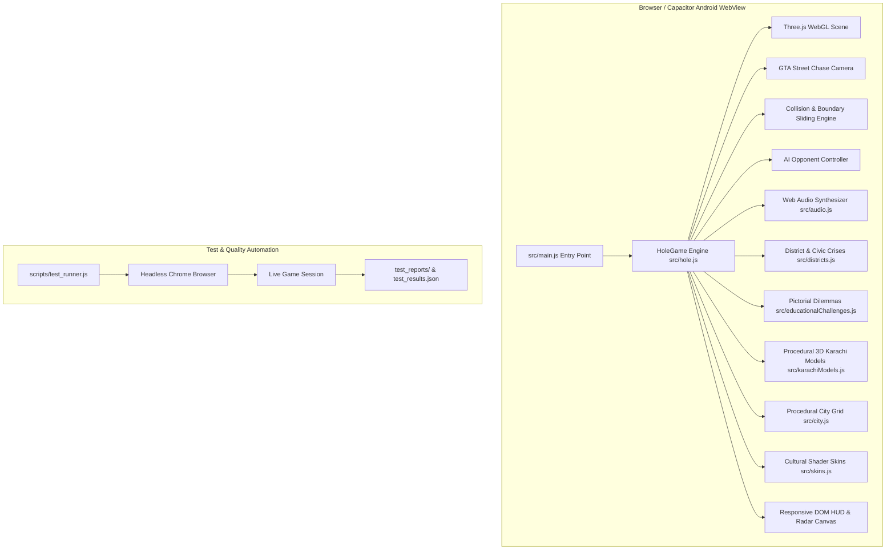

# Karachi Hole.io - Technical Architecture & Systems Design

This document details the software architecture, rendering pipeline, 3D mathematical models, physics simulation, and native mobile bridge powering **Karachi Hole.io: The City Savior**.

---

## 1. System Overview & Component Architecture



---

## 2. Source Code Modular Organization

| Module | Location | Primary Responsibilities |
| :--- | :--- | :--- |
| **Main Bootstrap** | `src/main.js` | Initializes DOM listeners, splash screen, and instantiates `HoleGame`. |
| **Game Engine** | `src/hole.js` | WebGL scene graph, render loop, camera chase math, devour physics, leaderboard, HUD update cycle, auto-pause listeners. |
| **District System** | `src/districts.js` | Karachi district progression (Saddar, Clifton, Korangi, Lyari, Malir), civic crisis definitions, before/after transformations. |
| **Educational Engine** | `src/educationalChallenges.js` | Age-calibrated pictorial quiz dilemmas (Kids, Junior, Adult), reward payouts, non-skippable dialog state. |
| **Karachi Models** | `src/karachiModels.js` | Procedural 3D geometry for Mazar-e-Quaid, Teen Talwar, Empress Market, Port Grand, cranes, tankers, Edhi ambulances. |
| **City Generator** | `src/city.js` | Procedural Karachi road network, intersections, sidewalks, streetlights, billboards, and devourable urban props. |
| **Skin System** | `src/skins.js` | Procedural canvas textures & ring shaders (Pakistani Truck Art, Sindhi Ajrak, Green Crescent, Gold Star). |
| **Audio Synthesizer** | `src/audio.js` | Synthesizes swallowing pops, water splashes, police sirens, and fanfare using Web Audio API (0 external MP3 files). |
| **Test Runner** | `scripts/test_runner.js` | Headless Chrome automated test suite executing 10 deterministic test cases with screenshot captures. |

---

## 3. 3D Camera & Visual Mechanics

### Subway Surfers / GTA Third-Person Street Chase Math
Rather than using a detached top-down isometric view, Karachi Hole.io employs an intimate street-level chase camera that places the player inside the bustling corridors of Karachi:

```
                  Horizon Look Target (player.x, 1.2, player.z - 4.5)
                            ▲
                           /
                          / (tilt angle ~22°)
                         /
Camera [Cam] ───────────► Hole [Player]
  Height: Y = 2.65 + r * 0.62
  Distance: Z = player.z + 4.6 + r * 0.95
```

#### Mathematical Formulation:
1. **Vertical Elevation ($Y$)**:
   $$Y_{\text{cam}} = 2.65 + r \times 0.62$$
   *Where $r$ is the dynamic radius of the hole. As the hole grows, the camera smoothly zooms out just enough to keep the rim in frame while preserving ground-level immersion.*

2. **Longitudinal Distance ($Z$)**:
   $$Z_{\text{cam}} = Z_{\text{player}} + 4.6 + r \times 0.95$$
   *Keeps the camera positioned immediately behind the rear rim of the hole.*

3. **Lateral Steering Banking**:
   When the player turns left or right, a slight roll ($\pm 0.08\text{ rad}$) and lateral sway ($X_{\text{offset}} = -V_x \times 0.35$) is applied to simulate the sensation of a high-speed vehicle or chase runner.

4. **Horizon LookAt Target**:
   $$\text{Target} = (X_{\text{player}}, 1.2, Z_{\text{player}} - 4.5)$$
   *Directs the player's view down the avenue toward distant Karachi landmarks rather than looking straight down at the asphalt.*

---

## 4. Physics, Collision & Anti-Stick Sliding

### The Corner Trapping Problem & Resolution
In standard boundary clamping, if a player moves diagonally into a corner $(X_{\text{max}}, Z_{\text{max}})$, setting coordinates to the clamped maximum creates friction lock, freezing the player.

### Vector Decomposition Boundary Deflection
The engine implements smooth wall sliding by decoupling the movement axes:

```javascript
// Axis-decoupled movement with corner buffer
const margin = mapLimit - player.radius;

// Test X movement independently
const nextX = player.position.x + moveX * speed * dt;
if (Math.abs(nextX) < margin) {
  player.position.x = nextX;
} else {
  // Deflect along the boundary wall
  player.position.x = Math.sign(nextX) * margin;
}

// Test Z movement independently
const nextZ = player.position.z + moveZ * speed * dt;
if (Math.abs(nextZ) < margin) {
  player.position.z = nextZ;
} else {
  // Deflect along the boundary wall
  player.position.z = Math.sign(nextZ) * margin;
}
```

This guarantees that moving diagonally into a wall redirects 100% of the tangential velocity component along the street corridor, allowing the player to slide fluidly around corners.

---

## 5. Dynamic Building Occlusion Ghosting

Because the camera stays low to the asphalt, skyscrapers and flyovers can occasionally obstruct the line of sight between the camera and the hole.

### Raycasting Transparency Pass
1. A ray is cast every frame from `camera.position` to `player.position`.
2. All intersecting building meshes are gathered.
3. For each occluding building:
   - The original opacity and depth write states are cached.
   - Material parameters are toggled to ghost mode:
     ```javascript
     mesh.material.transparent = true;
     mesh.material.opacity = 0.15;
     ```
4. When the camera moves past the obstruction, the building smoothly lerps back to full opacity (`1.0`).

---

## 6. Real-Time Stencil Hole CSG Rendering

To create the illusion that the ground has an actual physical hole where buildings tumble down:
1. **Ground Plane**: Rendered with standard depth and color writing.
2. **Hole Disc**: A circular geometry placed at $Y = 0.01$ with a custom fragment shader that writes to the stencil buffer and clears depth buffer values inside the circle radius.
3. **Interior Cylinder**: A dark textured cylindrical cavity positioned below the street ($Y \in [-3, 0]$) with inverted normals, simulating an underground abyss.
4. **Devour Transition**: Objects falling into the hole are detached from the city grid, given gravity velocity ($V_y = V_y - 9.8 \times dt$), scaled down exponentially ($S = S \times 0.92$), and removed from memory once $Y < -4\text{m}$.

---

## 7. Capacitor Android Native Bridge

```
┌────────────────────────────────────────────────────────┐
│                   Android OS Kernel                    │
├────────────────────────────────────────────────────────┤
│           Capacitor Native Activity (Java/Kotlin)       │
│  - AndroidManifest.xml: Hardware Acceleration Enabled  │
│  - Immersive Full-Screen Sticky Flags                  │
│  - AssetManager serving public/ and dist/ via file:// │
├────────────────────────────────────────────────────────┤
│             Chromium WebView (Hardware WebGL 2.0)      │
│  - Three.js WebGLRenderer                              │
│  - Web Audio Context (Hardware DAC)                    │
│  - TouchEvent Listener (Multi-Touch Pointer API)       │
└────────────────────────────────────────────────────────┘
```

- **AndroidManifest Configuration**:
  - `android:hardwareAccelerated="true"` ensures the Mali/Adreno GPU executes Three.js shaders natively.
  - `android:screenOrientation="sensor"` allows fluid play on both tablets (landscape) and phones (portrait).
- **Audio Context Auto-Unlock**:
  - Android WebViews suspend audio until user interaction. The engine hooks the first touchstart event to call `audioContext.resume()`.

---

## 8. Automated Testing Pipeline

The automated test runner (`scripts/test_runner.js`) validates all architectural layers:
- **Build Layer**: `vite build` compilation and tree shaking.
- **Module Layer**: ES import resolution.
- **State Layer**: Onboarding name/age setting, quiz dialogs, and pause state.
- **3D Geometry Layer**: Mathematical validation of camera vectors and coordinates.
- **Layout Layer**: DOM bounding box collision detection across simulated viewports.
